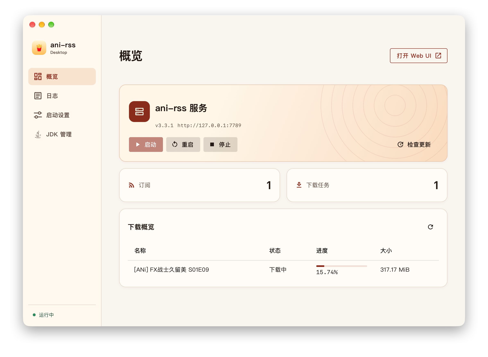
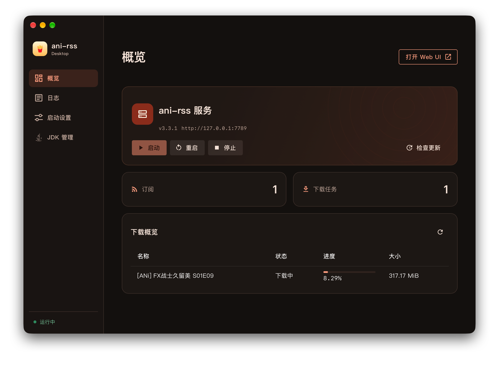

# ani-rss 桌面端

ani-rss-desktop 用于管理本机的 ANI-RSS 服务。可以启动、停止、重启或更新服务，管理 JDK，查看日志、订阅数量和当前下载任务。通过
**概览 → 打开 Web UI** 添加订阅和配置下载器。

<!-- 截图跟随文档站主题，优先使用 AVIF。 -->
<picture class="light-only">
  <source srcset="../image/screenshot/desktop.avif" type="image/avif">
  
</picture>
<picture class="dark-only">
  <source srcset="../image/screenshot/desktop-dark.avif" type="image/avif">
  
</picture>

::: tip 桌面端迁移
后续版本中，ANI-RSS 主项目将停止发布各平台的桌面安装包，Windows、macOS 和 Linux 的桌面安装包将统一由 **ani-rss-desktop** 提供。现有桌面用户可按下文安装 ani-rss-desktop，并在 **启动设置 → 配置与数据目录** 选择原来的 ANI-RSS 数据目录，继续使用已有配置和订阅。
:::

## 下载安装

打开最新发行页，在 **Assets** 中按系统选择文件。下表中的 `<版本>` 对应发行版本号。 [下载 ani-rss-desktop](https://github.com/wushuo894/ani-rss-desktop/releases/latest)

| 平台 | 下载文件 | 安装或启动 |
| --- | --- | --- |
| macOS Apple Silicon（arm64） | `ani-rss-desktop-<版本>-arm64.dmg` | 打开磁盘映像，将应用拖到「应用程序」，再从「应用程序」打开。 |
| Windows x64（amd64） | `ani-rss-desktop.exe` | 下载后直接运行。应用需要 WebView2 Runtime。 |
| Debian / Ubuntu x86_64（amd64） | `ani-rss-desktop_<版本>_amd64.deb` | 在下载目录运行 `sudo apt install ./ani-rss-desktop_<版本>_amd64.deb`，将 `<版本>` 换成实际版本号。 |
| Fedora 等 RPM 发行版 x86_64（amd64） | `ani-rss-desktop-<版本>-1.x86_64.rpm` | 以 Fedora 为例，在下载目录运行 `sudo dnf install ./ani-rss-desktop-<版本>-1.x86_64.rpm`，将 `<版本>` 换成实际版本号。 |

Linux 需要 GTK 3 和 WebKitGTK 4.1，显示托盘图标还需要 AppIndicator 支持。

各系统的 WebView 和托盘依赖见 MyGo
文档。 [系统依赖](https://mygo.run/docs/getting-started#install) · [托盘支持](https://mygo.run/docs/menus#tray-icons)

### 使用脚本安装

在 GitHub 发行页的 **Assets** 中确认有对应平台的安装脚本。脚本会下载并安装最新发行版。 [桌面端发行页](https://github.com/wushuo894/ani-rss-desktop/releases/latest)

**Linux x86_64** 使用普通用户打开终端，运行以下命令。安装完成后可从应用菜单打开 ani-rss-desktop。

```sh
curl -fsSL https://github.com/wushuo894/ani-rss-desktop/releases/latest/download/install.sh | sh
```

**Windows x64** 打开 PowerShell，运行以下命令。脚本会校验安装程序的 SHA-256，安装完成后自动打开应用。应用需要 WebView2 Runtime。

```powershell
irm https://github.com/wushuo894/ani-rss-desktop/releases/latest/download/install.ps1 | iex
```

### 使用 Homebrew 安装

搭载 Apple Silicon 且运行 macOS 12 或更新版本的 Mac 可以使用 Homebrew 安装。

```sh
brew install --cask wushuo894/tap/ani-rss-desktop
```

通过 Homebrew 升级时运行以下命令。

```sh
brew upgrade --cask wushuo894/tap/ani-rss-desktop
```

## 首次启动

1. 打开 **JDK 管理**，选用已发现的 Java 25 或更新版本。桌面端会检查 `JAVA_HOME`、`PATH` 和 macOS 系统登记的默认 JDK。可以点击
   **扫描本机** 重新检测，或者通过 **手动添加** 选择 JDK 目录或 Java 可执行文件。
2. 需要安装 JDK 时，在 **下载 Eclipse Temurin** 中从发行版本列表选择 Java 25，点击 **下载 JDK**。如果已经选用了其他
   JDK，点击新条目旁的 **选用**，下一次启动时生效。
3. 如果现有订阅要继续使用，在 **启动设置 → 配置与数据目录** 选择已有的 ANI-RSS 数据目录并保存。先停止原来运行的 ANI-RSS
   实例，再由桌面端启动。
4. 在 **概览** 点击 **启动**。桌面端在本机缺少 `ani-rss.jar` 时会联网下载并校验发行包。运行后可点击 **打开 Web UI**
   ，按快速开始的说明配置下载器和订阅。 [快速开始](/start)

桌面端下载的 JDK 可在列表中 **删除**，同时清理安装文件。手动添加或自动发现的 JDK 可 **移除** 列表记录。移除正在使用的 JDK
前，先停止服务，或切换 JDK 后重启。

## 启动设置

| 设置              | 用法                                                                                            |
|-------------------|-------------------------------------------------------------------------------------------------|
| 配置与数据目录    | 默认 `~/ani-rss/`，对应服务的 `--config`。服务的 `config.v2.json`、订阅和日志保存在这个目录中。 |
| 服务端口和绑定 IP | 默认 `7789` 和 `0.0.0.0`。将绑定 IP 设为 `127.0.0.1` 可限制为本机访问。                         |
| Java 虚拟机       | 支持调整初始堆内存、最大堆内存和额外 JVM 参数。额外参数每行一项。                               |
| Swagger 和 MCP    | 默认关闭。开启并重启服务后，可直接打开 Swagger 文档或复制 MCP 接入地址。                        |
| 登录时启动        | 登录操作系统时自动启动桌面端和 ANI-RSS 服务。macOS 使用安装后的 `.app` 注册登录项。             |

桌面端配置保存在当前用户主目录下的 `ani-rss-desktop/settings.json`，Windows 对应
`%USERPROFILE%\ani-rss-desktop\settings.json`。点击 **查看启动命令** 可复制当前进程或下次启动使用的命令。调整服务参数后，可以点击
**保存设置** 留待下次启动，或点击 **保存并重启** 立即应用。

## 概览、日志和更新

- **概览** 自动读取正在运行的实例的 `config.v2.json` 中的 `apiKey`，用于请求订阅数量和下载状态。概览免登录，打开 Web UI
  时仍按服务的访问控制设置访问。如果概览提示 API Key 缺失，检查启动设置中选用的数据目录。 [安全设置](/config/security)
- **日志** 显示 Java 进程输出，支持搜索、复制和打开服务日志目录。刷新后会自动滚动到底部。
- **登录信息** 可在 **启动设置 → 桌面与账户 → 重设密码** 修改。弹窗会带出当前的 Web UI 用户名，用户名可编辑。新密码只需输入一次，输入时明文显示。服务正在运行时，保存后会重启服务以应用修改。
- **服务更新** 可从 **概览 → 检查更新** 更新 ANI-RSS 服务。支持桌面端自更新对接的服务版本也可以从 Web UI 或通过定时任务发起更新，桌面端会在 Java 退出后替换 JAR 并重启服务。

## 托盘快捷面板

快捷面板显示服务状态、版本和操作进度，可打开 Web UI、启动、停止或重启服务，也可显示主窗口、检查桌面端更新或退出桌面端。主窗口和快捷面板的浅色与深色外观随系统切换。

macOS 和 Windows 上，左键或右键点击托盘图标都可打开快捷面板。Linux 上，从托盘菜单选择 **打开快捷面板**。点击面板外部或按 Esc 可收起面板。

托盘可用时，关闭主窗口会将应用收起到托盘，服务继续运行。选择 **退出桌面端** 会停止桌面端管理的服务。

## 桌面端更新

在 **启动设置 → 桌面与账户 → 桌面端更新** 或托盘快捷面板中检查更新。支持自更新的安装方式会在启动约 10 秒后自动检查，之后每天检查一次。更新窗口可查看发行说明、跳过版本或下载安装，并可选择立即重启或下次启动时应用。

若更新退出前 ANI-RSS 服务正在运行，桌面端下次启动时会按原先实际生效的 JDK 和启动参数恢复服务。

Linux 上，通过 `install.sh` 安装或解压到可写目录的版本支持应用内更新。`.deb` 和 `.rpm` 版本通过包管理器升级。AppImage 尚无应用内更新支持。
